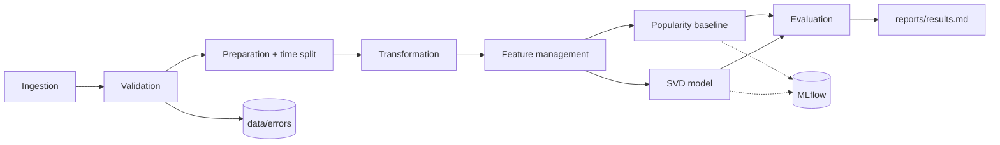

# Recommendation System Data Pipeline (DM4ML Assignment 2)

End-to-end, reproducible pipeline: ingestion, validation, preparation, transformation, feature management, model training, evaluation, orchestration.

## Stack
Python 3.12, pandas, scikit-learn, SciPy, MLflow (tracking), Prefect (orchestration). Dataset: MovieLens 100K.

## Architecture


## Setup
```
python -m venv venv
venv\Scripts\Activate.ps1
pip install -r requirements.txt
```
Download `ml-100k.zip` from https://files.grouplens.org/datasets/movielens/ml-100k.zip and extract it to `data/raw/` (the pipeline skips the download if `data/raw/ml-100k/u.data` exists).

## Run
```
prefect server start                       # terminal 1 (optional UI at http://127.0.0.1:4200)
prefect config set PREFECT_API_URL=http://127.0.0.1:4200/api
python -m dags.pipeline_flow               # terminal 2
mlflow ui                                  # experiment tracking at http://127.0.0.1:5000
```

## Structure
- `src/<stage>/`: one module per pipeline stage
- `dags/pipeline_flow.py`: Prefect flow (models train in parallel)
- `configs/config.yaml`: all paths and hyperparameters
- `reports/`: validation report, feature catalog, results table, screenshots
- `data/errors/`: rows rejected by validation

## Results
See `reports/results.md` for the model comparison (popularity baseline vs. SVD).

## Design decisions
- Time-based train/test split (no random split) to avoid temporal leakage
- Features and aggregates computed from the training set only
- One shared `build_features()` function for training and prediction
- Invalid rows are quarantined with reasons, not silently dropped